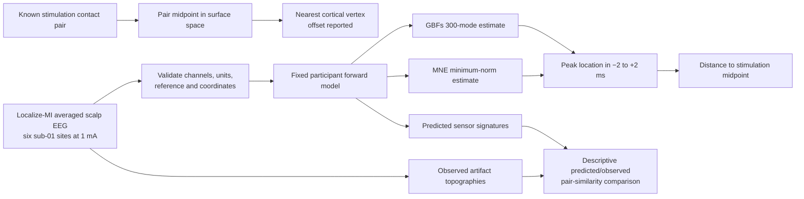

# Track A decisions and closure record

> **Acceptance status: Track A engineering foundation is accepted for the Track B research handoff after the sealed run passes the current validator.** Acceptance covers the declared one-participant pulse-artifact task, integration code, reproducibility controls and failure handling. It does not establish physiological localization, a calibrated RSG method, or novelty.

**Version 1.1 | 22 October 2026 | Development-only scope**

This record freezes the first empirical Track A task and distinguishes a software reproduction from a scientific validation claim.

## A0 design freeze

**Primary task:** localize the source of the short intracranial electrical stimulation artifact recorded by high-density scalp EEG. Localize-MI supplies the two stimulating contact coordinates. The benchmark reference is their midpoint, following the dataset authors' demonstration. It is not a ground-truth map of the subsequent physiological response or a claim about endogenous activity.

**Source family:** fixed-orientation cortical dipoles on the participant's supplied cortical mesh. Each contact-pair midpoint is mapped to its nearest cortical source vertex for the cortical localization-error comparison. The offset from the pair midpoint to that vertex is reported; no pair is treated as an exact cortical point source if the offset is material. The GBFs pipeline uses 300 geometric modes per hemisphere, matching the primary GBFs implementation setting. The existing 20-mode analysis remains a low-cost integration and nominal-signature demonstration, not the empirical benchmark configuration.

**Observation:** average the dataset's already aligned trials and evaluate the stimulation artifact in the prespecified −2 to +2 ms interval around event time zero. The Localize-MI event metadata identify site and current. The primary site comparison uses the six distinct sub-01 sites recorded at 1 mA. The paired 5 mA sessions are a secondary intensity sensitivity check, not extra independent sites.

**Nuisance treatment:** source amplitude and polarity are not used to choose a location; localization uses the maximum absolute estimated cortical response in the fixed observation window. Pulse latency is taken from the dataset's alignment and event zero, not re-estimated against the target. Source orientation is fixed to the supplied cortical normal. No other orientation is fitted. The run-level inverse settings are frozen before computing target errors.

**Reference and noise:** match the source-study's average reference over usable scalp channels and apply it consistently to data, leadfield and covariance. Estimate noise only from the prespecified pre-event window (−200 to −50 ms) in these already baseline-corrected epochs, with 10% diagonal shrinkage for the existing nominal-signature analysis. The empirical benchmark records covariance rank and keeps the same sensor set across its six primary sites. The covariance scaling assumption for trial averages is documented and sensitivity-checked; it is not treated as established population noise.

**Comparators:** unchanged upstream GBFs at Lambda=1.2 and 300 modes per hemisphere; fixed-orientation MNE minimum norm at lambda2=1/9; the existing nominal source-signature and MNE resolution-matrix diagnostics. These are prespecified fixed comparators, not a hyperparameter search.

**Data split:** all sub-01 runs remain development data. No held-out participant claim is made. The six-site association between predicted and observed scalp-pattern similarity is descriptive, with pairwise comparisons recognized as dependent.

### Data flow

## A1–A7 evidence ledger

| Gate | Evidence required | Current evidence | State |
|---|---|---|---|
| A0 | Frozen target, signal window, source family, nuisance rules, comparisons and data flow | This record and the [foundation protocol](foundation-protocol.md); target-to-cortex offsets in `case_validation.json` | Passed for the development task |
| A1 | Exact environment, pinned source versions, checksum manifest, clean reproduction | 34 exact package pins; uniquely named run; source snapshot and input/output SHA-256 manifest; pinned upstream commits | Pass is recorded in the run manifest |
| A2 | Channel order/geometry, units/reference/covariance, transform and target checks | Case validation plus all-run checks of units, events, dimensions, timing grid, finiteness and common channels | Pass for integration case and all 11 development runs; target/orientation limitation is retained |
| A3 | Paper-to-code trace, parity and separately named data adaptation | `docs/foundation/reverse-engineering.md`, `gbfs_parity.json`, frozen 300-mode recorded-data evaluation | Passed for numerical parity and the declared Localize-MI adaptation; not a GBFs paper-benchmark reproduction |
| A4 | Complete deterministic nominal signature library and edge-case tests | Stable ranking, null/support rejection, complete CSR threshold sets, runtime/RSS record and adversarial fixtures | Pass for 8,196 source vertices; scores remain nominal |
| A5 | Nominal ambiguity, resolution comparison, sensitivity and limitations | Complete ≥0.95 ambiguity sets, point-spread L1 mass, sensitivity variants, explicit model limits | Pass as nominal diagnostics; no calibration claim |
| A6 | One-command reproduction, offline report, user instructions and output validator | Unique immutable run folders, cold basis generation, sensor-signature plot, source/input/output hashes, corruption-resistant validator | Pass is recorded in the sealed manifest |
| A7 | Development evaluation, failure catalogue, frozen API and Track B handoff | Six-site descriptive result, limits, versioned interface, plausible but unresolved gap rationale | Pass for foundation freeze; Track B novelty and physiological validation remain open |

## Claim boundary

Track A establishes whether the selected implementation runs, whether its algebra matches the pinned upstream routine on identical inputs, and how fixed inverse estimates compare with known stimulation sites in this development subset. It does not establish cross-participant performance, physiological-source localization, a calibrated recoverability score, or novelty of Recoverable Source Geometry. Track A is accepted as an engineering and exploratory foundation for beginning Track B research. Track B still requires a complete method-level prior-art decision, physically valid task/data, and held-out evidence before a new-method claim.

The Localize-MI benchmark's known stimulation contacts are ground truth for the pulse-artifact localization task. They are not ground truth for distributed physiological responses after stimulation. Results from sub-01 remain development results because that participant and run have already informed design decisions.
